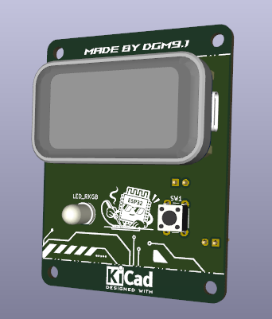
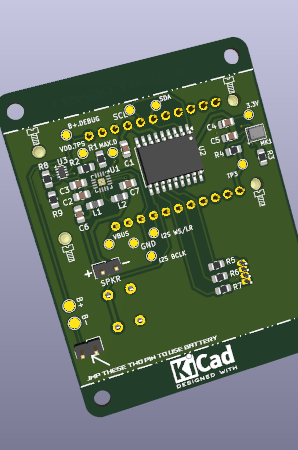
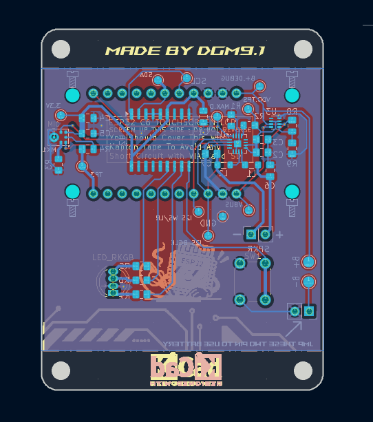
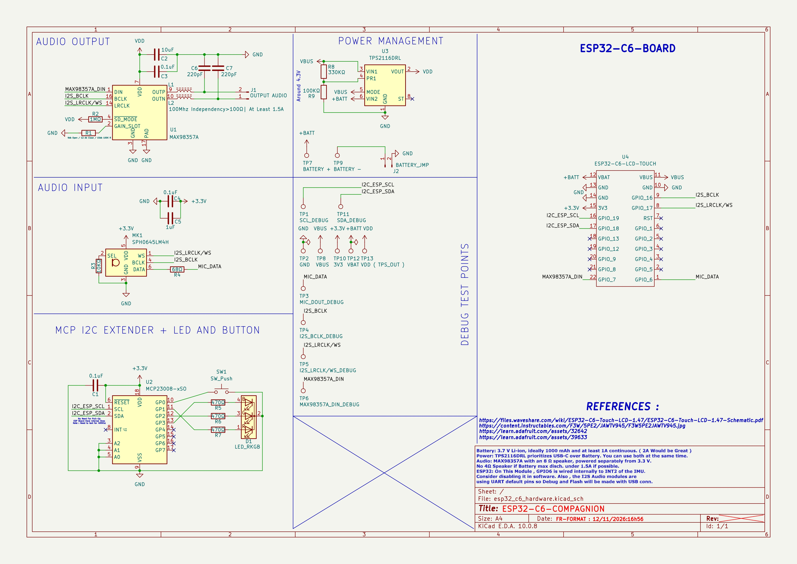

# ESP32 C6 Project ! 👋

Welcome to my repository. Here you will find every informations you need to build a small esp32 deskbot with usefull features and gadgets that other deskbot does not have.

## Introduction

So what is the ESP32 C6 Project ?

This project is a deskbot , but also a good Classmate and an AI Teacher. 
This project came from a very random idea : i wanted to build something usefull for me and other students , but also something that look's cool and that is easy to carry.
I chose this esp board because i've seen a lot of people using it and i wanted something compact , with good documentations , and with a lot of integrated features.

The main idea of this project is to make a bot that can listen to your teacher in class , and transcript your whole lessons into text or in markdown.
This idea came to me since i started working on a computer at school , because it's very difficult to stay attentive and you easilly manage to miss some important thing the teacher might say to you.
With this little gadget , you'll never be afraid of missing a part of your lessons and will be performing in class !

## How it Works ?

> [!NOTE]
>  _The Overall Project is in current developpement and some things may change with time , stay tuned !_

This project work with a custom pcb board and a waveshare dev board that both includes different features :

- A Gyroscope
- An SD card reader
- An USB interface
- A Tactile Screen
- Some Audio Output and Input Components
- A Physical button because it's always better to feel things !

Normally , i should use all of those features in this project : 

 - i want to use the audio for AI assistant and listen to teacher ,
 - the sd card might be used to save audio file on it or for the display , 
 - the gyroscope will be to interact with the bot to make some animations , 
 - usb interface should be used to transfert file from sd card , flash and program the esp32 , and even maybe emulate an HID device to write directly like a keyboard.
 - The tactile screen will be showing the bot eyes , battery and maybe a spotify or audio integration , settings etc.
 - tactical button will be used to start and stop recording , power On/Off device ( deep sleep ) and maybe other features.

The PCB board also include a Battery connector , and a Power Mux , wich will negociate beetween USB-C power and Battery power , this ensure the board does not have any short circuit or problem with power.

## Programmation and Software !

> [!CAUTION]
> Hackclub Please Read This : [README.md](Software/README.md).

IMPORTANT : The esp32 board doesn't had many pins left and the main idea was still to use all of the feature , since the board got an usb port , i used the UART default pins for the I2S audio , and GPIO6 as DOUT for the Microphone.
Here is what you ABSOLUTELY NEED TO DO : 

> Disable the IMU interrupt pin 2 : GPIO6 is used for this purpose as default , but we need to have the audio so , byebye !
> 
> Re-route I2S pin to the default UART pins and disable UART pins : we should not need them.
> 
> Select The USB CDC interface in Arduino IDE

Software will be released as soon as everything is put together !

## Hardware 

### Here is a BOM of the part you need to build ONE board :

Look at : [BOM.csv](BOM.csv) or [BOM.txt](BOM_INFO/BOM.txt)
>[!NOTE]
>In bom.csv there is only the part i need and taxes, parts i have and battery etc will be put in later since i need to try out different batteries , sd etc

_Main Components_

| Qty | Component | In Stock |
|:---:|---|:---:|
| x1 | ESP32-C6 1.47" LCD Touchscreen Board | No |
| x1 | MAX98357A | No |
| x1 | Resistor 1 MΩ | No |
| x2 | Capacitor 220 pF | No |
| x2 | Ferrite Bead ( 100Ω<Independecy at 100Mhz | No |
| x1 | Capacitor 10 µF | No |
| x1 | Capacitor 0.1 µF | No |
| x1 | Resistor 100 kΩ (Optional) | No |
| x1 | SPH0645LM4H | No |
| x1 | Resistor 10 kΩ | No |
| x1 | Resistor 68 Ω | No |
| x1 | Capacitor 1 µF | No |
| x1 | Capacitor 0.1 µF | No |
| x1 | MCP23008 | No |
| x1 | Capacitor 0.1 µF | No |
| x3 | Resistor 470 Ω | No |
| x1 | RGB LED | Yes |
| x1 | Push Button | Yes |
| x1 | TPS2116DRL | No |
| x1 | Resistor 330 kΩ | No |
| x1 | Resistor 100 kΩ | No |

_Additional Components_

| Qty | Component | In Stock |
|:---:|---|:---:|
| x1 | PCB Board | No |
| x1 | SD Card | No |
| x1 | Speaker 8 Ω | Yes |
| x1 | Compatible Battery | Yes |
| x1 | Battery ON/OFF Switch | Yes |

>[!WARNING]
>**Battery Switch:** If no switch is used, the two pads can simply be bridged with a jumper.
>
>**SD Card Safety:** Be careful to remove any power source before working with the SD card.
>
>**3D Model:** For now the 3D model doesn't exist since i need to try different batteries , but you'll need to adapt it if you don't use the one i'll select.
>
>**Audio Gain:** The 100 kΩ resistor for gain tuning is optional, and you can jump it or leave it without.

## 3D Model and Parts 

> [!CAUTION]
> Hackclub Please Read This : [README.md](CAD/README.md).

In the CAD folder , you'll find a .step file of the whole pcb with every components execpt the MAX98570 but it's not really harmfull.
3d parts are Comming , please wait until i can actually mesure the real size of the board and the battery i'm gonna be using etc...

### Some Pictures Of This Project ! 

( UPDATED )

